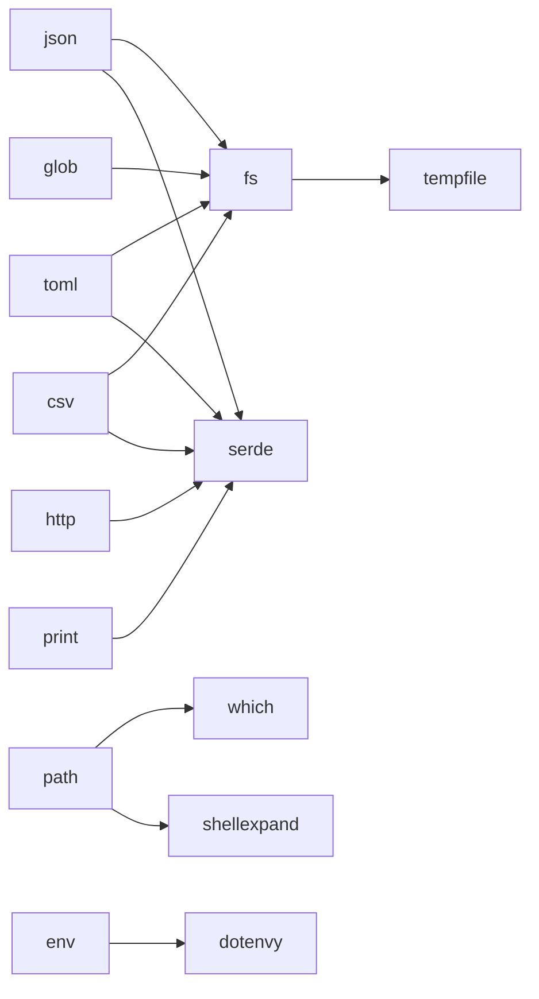

# ADR 0006: Granular Features for the Core Modules

## Status

Accepted (0.3.0). Extends [ADR 0004](0004-module-independence.md).

## Context

Up to 0.2, `env`, `fs`, `path` and `sh` were always compiled, so even
`default-features = false` pulled in `serde`, `serde_json`, `toml`, `glob`,
`tempfile`, `which`, `dirs`, `shellexpand` and `dotenvy`.

That is fine for a standalone script, but smop's best fit turned out to be
`cargo xtask` crates: they need exactly `sh::cmd`, path-naming `fs` errors,
`fs::temp_dir` and `path::which`. An xtask is a workspace member, so every one
of its dependencies is compiled by `cargo build --workspace` and shows up in
the workspace's `Cargo.lock` (and in `cargo deny` duplicate-version reports).
In practice adopting smop in Autumn's xtask would have added a third `toml`, a
second `which`, and `dirs`/`shellexpand` — against that project's
"xtask stays dependency-light" rule — to replace about 60 lines.

## Decision

Every module gets its own feature, and `anyhow` is the only unconditional
dependency:

```toml
[features]
default = ["full"]
full = ["sh", "fs", "path", "env", "json", "toml", "glob",
        "http", "cli", "print", "csv", "time", "archive"]

sh    = []
fs    = ["dep:tempfile"]
path  = ["dep:which", "dep:shellexpand"]
env   = ["dep:dotenvy"]

serde = ["dep:serde"]
json  = ["fs", "serde", "dep:serde_json"]
toml  = ["fs", "serde", "dep:toml"]
glob  = ["fs", "dep:glob"]
csv   = ["fs", "serde", "dep:csv"]
```

Supporting choices:

- **Format helpers are features of `fs`, not separate modules.** `fs::read_json`
  stays where users expect it; `json`/`toml`/`glob`/`csv` simply imply `fs`.
- **`dirs` is dropped.** `std::env::home_dir` was fixed on Windows in Rust 1.85
  and un-deprecated in 1.87; the MSRV is 1.88. `shellexpand` is used with
  `default-features = false` (its `tilde` feature is what pulls in `dirs`),
  passing our own home-dir lookup to `full_with_context`.
- **`serde` is a named feature** so the prelude can re-export
  `Serialize`/`Deserialize` under `cfg(feature = "serde")`.
- **xtask ergonomics live in the core modules**, so they cost nothing extra:
  `sh::cargo()` (honours `$CARGO`), `CommandBuilder::{echo, success,
  env_remove}`, a `Display` impl, errors that name the full command line,
  `path::workspace_root()`, and `fs::create_dir_all()`.



## Consequences

### Positive

- `features = ["sh", "fs", "path"]` resolves to 12 crates on Linux (vs ~150 for `full`),
  and of those only `shellexpand` is likely to be new to a typical workspace.
- Scripts using the default `full` feature see no change.

### Negative

- **Breaking for `default-features = false` users**: they must now list the
  core modules they use (`features = ["sh", "fs", ...]`). Hence 0.3.0.
- More cfg combinations. CI now runs `cargo test` and `cargo clippy` for each
  feature on its own, plus the xtask set (`sh,fs,path`).
- Doctests that span modules (crate root, prelude) carry hidden
  `#[cfg(...)]` guards so they compile under any feature set.
