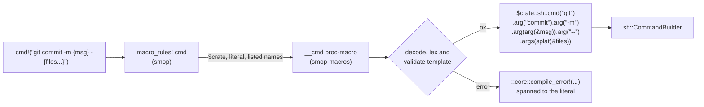

# ADR 0007: `cmd!` as a Zero-Dependency Proc-Macro

## Status

Accepted (0.4.0). Implemented: see
[Implementation notes](#implementation-notes). Extends
[ADR 0005](0005-cross-platform-shell-execution.md) and
[ADR 0006](0006-granular-core-features.md).

## Context

`sh::cmd("git").args(["commit", "-m", &msg])` gets argument quoting right,
but long command lines are hard to read. `sh::run("git commit -m ...")` reads
well, but it goes through a shell, so building one with `format!` lets values
be word-split or interpreted as shell syntax. Scripts want both: a command
line that reads like the shell and argv that can't be split or injected.

xshell's `cmd!` shows the shape:

```rust
let out = cmd!(sh, "git commit -m {msg} -- {files...}").run()?;
// argv: ["git", "commit", "-m", <msg>, "--", <file>, <file>, ...]
```

`{msg}` names a local and becomes exactly one argument. `{files...}` spreads
a list into one argument per item. Nothing is ever word-split again, and
there is no shell.

### Implicit capture needs a proc-macro

Making `{msg}` refer to the local `msg` means turning text inside a string
literal into an identifier. On stable Rust only `format_args!` can do that.
A literal can be forwarded to it unchanged, but it refuses a format string
that a macro produced, for example with `concat!` ([RFC 2795](https://rust-lang.github.io/rfcs/2795-format-args-implicit-identifiers.html):
"No implicit named argument capture will be performed if the format string
is generated from an expansion"). And the output of `format_args!` can't be
taken apart, because `fmt::Arguments` has no public structure. So a
`macro_rules!` macro can validate a template at compile time, but every
value has to be listed again after it: `cmd!("git commit -m {msg}", msg)`.

### "Proc-macros don't cache"

The worry was that a proc-macro would make rebuilds slower because its
output isn't cached. We investigated this before deciding:

- **Stable rustc caches no macro expansion, of any kind.** Every compile of
  a crate parses it, then expands and name-resolves the whole crate.
  Expansion and resolution run inside the `eval_always` query
  `resolver_for_lowering_raw`, whose provider calls `configure_and_expand`.
  Incremental reuse only starts after lowering to HIR
  ([rustc-dev-guide](https://rustc-dev-guide.rust-lang.org/overview.html),
  `compiler/rustc_interface/src/passes.rs`). We measured it: after a
  comment-only edit, or just a `touch`, all 200 proc-macro `cmd!` calls in a
  test crate ran again across all 4 modules. So did all 200 calls of a
  `macro_rules!` version (`-Zmacro-stats`).
- **cargo skips rustc entirely when nothing changed**, so no macro runs on a
  no-op build (0.023 s).
- **The only expansion cache is nightly `-Zcache-proc-macros`, for derives
  only.** It was merged in [rust-lang/rust#145354](https://github.com/rust-lang/rust/issues/145354) (1.94) and is tracked in
  [rust-lang/rust#151364](https://github.com/rust-lang/rust/issues/151364). The Unstable Book warns that with impure
  proc-macros it "can result in stale expansions being compiled", and
  `rustc -Z help` calls it "potentially unsound". With it on, derive re-runs
  went from 4 to 0, but function-like calls stayed at 200.

A proc-macro's real costs are at the build-system level, and they are
one-time:

- It is an extra host crate. cargo builds it once per profile (dev,
  release), once for builds with `--target` and once without, per
  `RUSTFLAGS` set (only when no `--target` is passed) and per target dir.
  Switching back to an earlier setting reuses the earlier build.
- [sccache can't cache](https://github.com/mozilla/sccache/blob/main/docs/Rust.md)
  `proc-macro` crates.
- `cargo check` has to build it fully (codegen and link). The artifact is
  then shared with `cargo build`, `test` and `doc`, and, for downstream
  users, with `clippy`. Inside smop's own workspace, clippy rebuilds the
  `smop-macros` member once.
- `cargo script` is still nightly-only (stabilization in [rust-lang/cargo#16569](https://github.com/rust-lang/cargo/issues/16569)
  is FCP-blocked), and it keys each script's build dir by the script's path.
  So every new or moved script compiles its dependencies once, the macro
  crate included.
- rust-analyzer can expand it only after cargo has built it.

### Measurements

These were taken on 1.97.0 (and spot-checked on 1.88), with five prototypes
that produce identical argv: two `macro_rules!` + `const fn` designs (one
with positional placeholders, one with named ones), a runtime template
function, a token-based macro, and a zero-dependency proc-macro. Each test
crate had 200 calls. Times are medians in seconds.

| Scenario | Plain builder | Proc-macro | Named `macro_rules!` | Positional `macro_rules!` |
|---|---|---|---|---|
| Edit one fn body, `cargo build` | 0.101 | 0.109 | 0.289 | 0.245 |
| Edit one fn body, `cargo check` | 0.080 | 0.079 | 0.197 | 0.205 |
| Clean `cargo build` | 0.38 | 0.77 | 1.29 | 1.12 |

The `macro_rules!` designs validate the template with const evaluation and
type-check a dispatch per argument at every call site. That costs about
0.6 to 0.9 ms per call on every rebuild of the crate. The proc-macro costs
about 0.04 ms per call. Its own clean build is about 0.33 s in isolation
(0.19 s in release). Inside smop's real dependency graph it builds in
parallel with smop's other dependencies (`anyhow`'s build script, plus
`tempfile` and `which` once `fs` and `path` are on), so wall time didn't
change. These rows are n=3, and the `full` row is within about ±0.5 s of
noise:

| smop features | Clean build without | Clean build with the macro crate |
|---|---|---|
| `sh` | 0.76 s | 0.80 s |
| `sh,fs,path` | 2.25 s | 2.18 s |
| `full` | 22.7 s | 22.8 s |

At script sizes (10 to 50 calls) every design is within about 0.01 to 0.05 s
per rebuild, so build speed doesn't decide this. What the numbers do show is
that the proc-macro is not the slow option.

## Decision

Ship `cmd!` as a function-like proc-macro in a new crate, `smop-macros`. It
has no dependencies: it uses the bare `proc_macro` API, with no `syn`,
`quote` or `proc-macro2`. A thin `macro_rules!` wrapper in smop is the
public entry point. There is exactly one implementation; no second
`macro_rules!` parser ships next to it.

### Crates and features

```toml
# smop/Cargo.toml
[workspace]
members = ["smop-macros"]          # tests/consumer keeps its own [workspace]

[workspace.lints]                  # moved from smop's [lints]; both crates
                                   # set `lints.workspace = true`

[features]
full   = [ ..., "macros"]
sh     = []                        # unchanged: still pulls in nothing
macros = ["sh", "dep:smop-macros"]

[dependencies]
smop-macros = { version = "=0.4.0", path = "smop-macros", optional = true }
```

```toml
# smop-macros/Cargo.toml (plus version, edition, license, description,
# repository, as crates.io requires)
[package]
name = "smop-macros"
rust-version = "1.89"              # moves with smop's MSRV

[lib]
proc-macro = true

[dependencies]                     # none
```

- `sh` stays dependency-free, as ADR 0006 promises. An xtask on
  `sh,fs,path` adds `macros` to get `cmd!`. That costs one extra crate with
  no dependencies of its own.
- The feature is called `macros` because the crate may hold more macros
  later. `success!`, `warn!` and `error!` stay under `print`.
- The versions are pinned in lock-step (`=0.4.0`). Releases use
  `cargo publish --workspace` (Cargo 1.90 or later), which publishes
  `smop-macros` first. `cargo package -p smop` on its own fails until that
  version is on crates.io. `cargo package` already leaves the
  `smop-macros/` directory out of smop's package.
- `#[macro_export] macro_rules! cmd` lives in `src/sh.rs` under
  `cfg(feature = "macros")`. The proc-macro is re-exported as a hidden item.
  The prelude gains `#[cfg(feature = "macros")] pub use crate::cmd;`
  ([ADR 0003](0003-prelude-design-philosophy.md)).

### How it expands



The `arg(..)` and `splat(..)` calls in the diagram stand for the type
dispatch described under the grammar.

The wrapper handles `name = expr` arguments, so the proc-macro never has to
parse Rust expressions:

```rust
#[macro_export]
macro_rules! cmd {
    ($template:literal $(, $name:ident = $value:expr)* $(,)?) => {
        match ($(&$value,)*) {
            ($($name,)*) => $crate::__private::__cmd!($crate $template $($name)*),
        }
    };
    ($($other:tt)*) => {
        ::core::compile_error!(
            "cmd!: write a string literal template, then `name = value` pairs"
        )
    };
}
```

- Each value is evaluated once, left to right, and borrowed.
- The proc-macro receives the `$crate` token and emits only `$crate::`
  paths and `::core::compile_error!`. That's why a script needs no direct
  dependency on `smop-macros`.
- The proc-macro also receives the listed names, so a listed name that the
  template never uses is a compile error, as it is with `format!`.
- Identifiers for `{name}` are created with the literal's span, so they
  resolve at the call site. This was verified to work through a user's own
  forwarding `macro_rules!`.
- A forwarded `$template:literal` arrives wrapped in an invisible group
  (`Delimiter::None`), which the proc-macro unwraps.
- Stable `proc_macro` has no accessor for a literal's value
  (`Literal::str_value` is unstable, `proc_macro_value`). So the proc-macro
  decodes `Literal::to_string()` itself: `\n \t \r \\ \" \' \0 \x.. \u{..}`,
  backslash-newline continuations and raw strings. Byte strings, C strings
  and suffixed literals are errors. The decoder has its own unit tests.

### Template grammar

The grammar starts strict. Each later relaxation is an additive change.

| Rule | Example | Result |
|---|---|---|
| The template is a string literal (raw strings allowed). | `cmd!(TEMPLATE)` | compile error |
| ASCII whitespace (space, `\t`, `\n`, `\r`, `\x0C`) separates words. Templates may span lines. | `"cargo test\n  --workspace"` | `["cargo","test","--workspace"]` |
| Other whitespace outside quotes is an error: any `char::is_whitespace` character that isn't ASCII whitespace (`\x0B`, NBSP, U+2000–U+200A, U+2028/2029, U+3000, ...) and the invisible U+200B and U+FEFF. | `"ls\u{a0}-la"` | compile error |
| An empty or blank template is an error. | `""` | compile error |
| The first word is the program. It may be `{name}`, but not a splat. | `"{cargo} fmt"` | program from a local |
| `{name}` is exactly one argument and may be glued to text. | `"--out={dir}"`, `"{user}@{host}:{path}"` | one element each |
| `{name}` accepts `AsRef<OsStr>` values (passed verbatim, no UTF-8 round trip), plus integer primitives and `char`. Other types need `.to_string()`. | `"-j{jobs}"` with `jobs = 8usize` | `"-j8"` |
| `{name...}` splices zero or more arguments from anything that iterates by reference over `AsRef<OsStr>` items, looking through references: `Vec`, arrays, `Option`, sets, and `&[T]` / `&Vec<T>` parameters. One-shot iterators must be collected first. | `"cargo build {verbose...}"` with `verbose: Option<&str>` | zero or one extra element |
| A splat must be a whole word: not glued, not quoted, not the program. | `"--x={xs...}"` | compile error |
| A splat of a `Path`/`PathBuf` is an error, since splitting a path into components is never intended. | `"ls {p...}"` | compile error: "a path is one argument: write `{name}`, not `{name...}`" |
| `'...'` and `"..."` group words. There are no backslash escapes inside; `{{`, `}}` and placeholders work as they do outside. `''` is an empty argument. | `"-m 'Release {v}'"` | `["-m","Release 1.2.0"]` |
| An opening quote must start a word or follow `=`. A closing quote must end the word. An unclosed quote is an error. | `"echo 'don't'"` | compile error, with the hint "for an apostrophe, quote with \"...\"" |
| `{{` and `}}` are literal braces. | `"find . -exec rm {{}} ';'"` | `["find",".","-exec","rm","{}",";"]` |
| Unquoted shell syntax is an error: `\|` `&` `;` `<` `>` or a backtick anywhere in an unquoted word; `$` followed by a letter, digit, `_`, `{` or `(`; and `~` or `#` at the start of a word. Quote them to pass them literally. | `"rm -f {f} && echo done"`, `"make 2>/dev/null"` | compile error: "cmd! runs one program, not a shell: quote it, or use `smop::sh::shell`" |
| `{}`, `{0}`, `{x:?}` and `{a.b}` are reserved. | `"echo {}"` | compile error |
| The result is the ordinary `sh::CommandBuilder`. | `cmd!(..).dir(&root).env(..).run()?` | unchanged builder API |

Notes on the rules:

- **A bare `;` is rejected, even though `find -exec` uses it.** It is a
  shell separator, so a bare `;` is far more likely a habit carried over
  from bash than an argument. `find` users write `';'`, which is also what
  a shell needs. The same goes for `&` in an unquoted URL.
- **Globs are not rejected.** `*.rs` reaches the program as literal text.
  `find -name *.rs` relies on that, and a program that gets an unexpanded
  glob usually fails loudly ("No such file").
- **Type dispatch uses autoref specialization at the call site.** A blanket
  `impl<T: AsRef<OsStr>>` next to impls for integers, or next to an impl
  for `PathBuf`, is a coherence error, so plain trait impls can't express
  these rules. The call-site dispatch picks `AsRef<OsStr>` first, then the
  integer and `char` impls, and a lowest-priority fallback turns anything
  else into a custom error ("cmd!: `{Self}` is not an argument; use
  `.to_string()`"). In generic code only the `AsRef<OsStr>` path applies.
  `#[diagnostic::on_unimplemented]` messages can name types but not the
  user's variable, so error texts say `{name}` literally.
- **Each rule comes from a failure the prototypes showed:**
  - `rm -f {f} && echo done` deleted a file named `done` and returned `Ok`.
  - `'Don't break' --author 'O'Brien'` silently regrouped into two different
    arguments.
  - `{p...}` with a `PathBuf` became `["/", "usr", "local", "lib"]`.
  - A positional design let swapped arguments of the same type compile.

### Errors

- Template errors are `compile_error!`s spanned to the whole literal. On
  stable, nothing can point inside a literal, because `Literal::subspan` is
  unstable (`proc_macro_span`). The message quotes the offending fragment
  instead.
- Errors are ordinary compile errors, so `cargo check`, clippy and
  rust-analyzer's check on save report them. (A `macro_rules!` design would
  have had to avoid inline `const {}` blocks: their panics are not evaluated
  in check builds, and appear only on a full build. This was verified on
  1.88 and 1.97.)
- A typo in a captured name is rustc's E0425 ("cannot find value
  `verison`"). Its suggested fix replaces the whole template literal with
  the similar name. Applying the fix would delete the template. There's no
  stable way to narrow that span, so the docs warn about it.
- A listed name that is also a constant in scope (`const dir: &str = ...;
  cmd!("ls {dir}", dir = ...)`) becomes a constant pattern in the wrapper's
  `match` and fails with E0308. `format!` doesn't have this problem. It is
  rare, because constant names are uppercase, and it is documented.

### Testing

- The decoder, lexer and validator are plain functions over `&str`,
  separate from token handling. They get unit tests and proptest round
  trips: every `{name}` maps to exactly one argv element, and literal text
  never splits a value.
- The lexer also has a Verus proof of these two properties. With archive
  path containment, it is one of the two pure pieces of smop where a proof
  pays for itself. Verus needs its own crates and a pinned toolchain, so
  the proof is in `verus/`, outside the published `smop-macros`, which
  keeps zero dependencies. See
  [ADR 0022](0022-verus-proof-of-the-cmd-scanner.md).
- A compile-fail suite covers every error rule above. It uses trybuild
  (a dev-dependency) and runs on one pinned stable toolchain on Linux,
  because its `.stderr` snapshots change between rustc versions.
- The `tests/consumer` crate enables `macros` and calls `cmd!`. That proves
  the `$crate` paths work without a direct dependency on `smop-macros`.
- CI adds `macros` to the per-feature test and clippy loops, and runs
  `cargo test --workspace` and `cargo clippy --workspace --all-targets`.
  Without `--workspace`, cargo tests and lints only the root package, so
  `smop-macros` would go unchecked.
- These regression cases from the prototypes become required tests:
  - hostile values as single, glued, quoted, program and splat arguments:
    `; rm -rf / #`, `$(id)`, newline, empty string, `{}`, both quote
    characters, NBSP, non-UTF-8 bytes
  - `{{}}`, `{{{x}}}` and `}}{{`
  - `{a}{b}` gluing into one element
  - evaluation order
  - hygiene for locals named like internal bindings
  - capture through a forwarding macro
  - splats of `&[T]` locals and of `name = &expr`
  - a listed name that shadows a constant (compile error, documented)

## Implementation notes

These points are more exact than the text above, or they come from the
implementation and its review.

**More compile errors.** Each one refuses a template that cannot work:

- A NUL character anywhere in the template. An argument cannot hold one.
- An empty program word: `cmd!("'' --version")`.
- A name that is a keyword or a reserved word of each edition, such as
  `{fn}` or `{do}`. `{self}` is permitted.
- A name that is not an ASCII identifier, such as `{r#type}`.
- Arguments that are not one literal, then `name = value` pairs. The
  wrapper has a second arm for them, so `cmd!(TEMPLATE)` gets a `cmd!`
  message and not "no rules expected this token".
- A splat of a `Result`. It iterates, but an `Err` gives no item, so a
  failure becomes zero arguments.
- A splat of text (`AsRef<str>`): it is one value.

**Keywords of later editions.** `async`, `await`, `dyn`, `gen` and `try`
are names. The macro writes such a name as a raw identifier, so `{gen}`
finds `r#gen`. A listed name can be raw: `r#try = 1`.

**Shell syntax.** `$` before a placeholder is an error too: `${name}` in a
template is `$` followed by `{`.

**Backslash.** A backslash outside quotes is text. `a\ b` is two words.

**Quotes.** A word has at most one quoted section, and a quote has no
escapes. So literal text with both `'` and `"` cannot be in a template.
Pass it as a `{name}` value.

**Path splats.** The path error is for each `AsRef<Path>` type that is not
text. So a path type of a different crate gets the error too, and does not
become one argument for each component.

**Reference depth.** A splat looks through four references at most, for a
captured name and for a listed name. `&mut` is not a reference here: write
`name = &*list`.

**The type of a value must be known at the call.** Method lookup cannot
test a bound on a type that rustc does not know yet. It takes the first
impl, which can be the wrong one. So the expansion first calls a method on
the value itself. That call is E0282 ("type annotations needed") for an
unknown type. `format!` accepts such a value, and `cmd!` does not. A list
with an unknown item type, such as a new `Vec`, is accepted.

**A command that never runs.** `cmd!("make");` gave no warning, because
the `#[must_use]` attributes were on the builder functions and the
expansion is a `match`. `sh::CommandBuilder` is now `#[must_use]` as a
type, and a compile-fail case keeps the warning.

**Type dispatch.** `src/__private.rs` holds it.

- A blanket trait gives each value a method that makes a wrapper.
- One method name has several traits. Each impl is for a different number
  of `&` before the wrapper, and method lookup tries the largest number
  first.
- The last impl always applies. Its method has a bound that no type
  satisfies. `#[diagnostic::on_unimplemented]` on that bound gives the
  custom message as E0277.

**The expansion** for `cmd!("git commit -m {msg} -- {files...}")`:

```rust
match () {
    () => {
        use smop::__private::traits::*;
        smop::sh::cmd("git")
            .arg("commit")
            .arg("-m")
            .arg((&&&msg.__smop_cmd_value()).__smop_cmd_arg())
            .arg("--")
            .args((&&&&&&&&files.__smop_cmd_list()).__smop_cmd_splat())
    }
}
```

- The import is one glob of a module that holds only traits. Each
  placeholder uses one of them, so the import is never unused, and the
  expansion needs no `#[allow]`. An `#[allow]` breaks a caller that
  forbids the lint.
- A trait name cannot hide a local of the caller.

**Spans.**

- A captured name gets the span of the literal itself. The invisible group
  around a forwarded literal has the span of the forwarding macro. A name
  with that span does not find the local of the caller.
- A listed name is the token that the caller wrote.
- Each other token has the hygiene of a macro (`Span::mixed_site`) and the
  location of the template. So `::core::compile_error!` resolves in an
  edition 2015 caller, and lints for user code do not check the tokens.

**Tests.**

- `smop-macros` unit tests and proptests: decoder, lexer and validator.
  One proptest compares the shell rule with a second implementation of
  the rule.
- `tests/cmd_macro.rs`: each valid row and each regression case. The
  program is a script that prints each argument with the `printf` of the
  shell, and the test reads back the argv (Unix). A `printf` program is
  not safe for this: one implementation removes a first `--`.
- `src/sh.rs` unit tests: the argv of the builder, on each platform.
- `tests/cmd_macro_lints.rs`: a caller that forbids `unused_imports`.
- `tests/ui/` and `tests/cmd_macro_errors.rs`: the error rows. The trybuild
  test is `#[ignore]` and runs in CI's `compile-fail` job, on a pinned
  toolchain and with the `macros` feature alone. `tests/ui/README.md` has
  the reason and the command. Two more tests, on each platform, check
  that each snapshot has the message of its rule and an error for each
  call.

## Alternatives Considered

1. **Named `macro_rules!` + `const fn`** (`cmd!("git commit -m {msg}", msg)`).
   This is the best design without a proc-macro, and it was the fallback.
   Every name is written twice. Rebuilds cost 2.5 to 2.9 times as much as
   plain code at 200 calls. Its error messages are limited to what a const
   panic can format, and they underline the whole call.
2. **Positional `macro_rules!`** (`cmd!("cp {} {}", src, dst)`). Swapped
   arguments of the same type compile silently, and values are moved, not
   borrowed. Its `$template:expr` would accept const items, which a later
   proc-macro could never accept, so that would have been a semver trap.
3. **A runtime template** (a `template("cp {} {}", (a, b))` function in
   `sh`). Template errors only appear when the line runs. A variant checked
   through an inline `const {}` block fails only on a full build, so
   `cargo check` and rust-analyzer miss it.
4. **A token macro** (`cmd!(git commit (-m) {msg})`). It rebuilds words
   from `stringify!` spacing, which is unspecified. `git add .` becomes
   `["git","add."]`, rustfmt rewrites `rm -rf {dir}` to `rm - rf { dir }`,
   and a `/* */` across glob words silently drops text.
5. **A hybrid**: the named `macro_rules!` design plus an opt-in proc-macro
   that only appends missing names. It works, and it was verified on 1.88
   and 1.97. The review scored it highest on ergonomics (9, against 8 for
   the named design and 7 for the proc-macro baseline), while the
   proc-macro won on correctness (8 against 7) and on build cost and fit
   (8 against 5 or lower). But getting capture still needs a published
   proc-macro crate, the slower const-eval path stays, and two scanners
   must agree on what a placeholder is. The baseline's ergonomic gaps
   (integers, `Option` splats) are closed by the grammar above.
6. **A `syn`-based proc-macro.** The `syn` + `quote` + `proc-macro2` stack
   is about 2 to 2.5 s of clean build (`syn`'s default vs `full` features)
   against 0.3 to 0.4 s for the zero-dependency crate, and a string grammar
   doesn't need it.

## Consequences

### Positive

- Shell-like command lines with no word splitting and no shell injection,
  checked at compile time and reported by `cargo check`, clippy and
  rust-analyzer.
- Placeholder syntax from xshell (`{name}`, `{name...}`, `'...'`), close to
  `format!`, so it is easy to learn.
- It is the cheapest macro on every rebuild, about as cheap as hand-written
  builder calls.
- The parser is ordinary Rust, so its error messages use `format!` and it
  can be tested directly.
- `sh` and the xtask feature set (`sh,fs,path`) keep their dependency list.

### Negative

- A second published crate. Releases need a lock-step version pin and
  `cargo publish --workspace`.
- About 0.3 s CPU per clean build per profile, `--target` mode,
  `RUSTFLAGS` set and target dir. In smop's graph this is hidden by
  parallel builds, but it shows at `-j1`. sccache can't cache it.
- rust-analyzer needs the macro built, and depends on the toolchain's
  proc-macro server.
- Errors underline the whole literal, and rustc's suggestion for a misspelled
  captured name is destructive (see Errors).
- xtasks on `sh,fs,path` must add `macros` to use `cmd!`.

### Verified during implementation

**rust-analyzer** (1.97.0, through its LSP server, on a crate that depends
only on smop):

- "Expand macro" shows the full expansion in one step, through the
  `macro_rules!` wrapper and the proc-macro. The text is in
  [Implementation notes](#implementation-notes).
- For a template error, the expansion shows the `::core::compile_error!`
  call with the message.
- Hover on `cmd!` shows the doc comment of the macro.
- Errors come from the `cargo check` that rust-analyzer runs on save. They
  underline the template literal.
- Three errors show this: a template error, an unknown name (E0425) and a
  wrong type (E0277, with the custom message).
- rust-analyzer adds no diagnostic of its own.

**Clippy at call sites** (1.88, 1.89, 1.97 and 1.99, with `all`, `pedantic`,
`nursery` and `restriction` on):

- The expansion causes no lint. Each diagnostic is for code that the
  caller wrote, for example `min_ident_chars` for a listed name `a`.
- 1.88 is below the MSRV. That run used `--ignore-rust-version` and the
  `macros` feature only.
- smop's own `cargo clippy --workspace --all-targets --all-features -- -D
  warnings` is clean on 1.97 and 1.99. On 1.89 it reports only
  `needless_doctest_main` in `src/script.rs`, which is not `cmd!` code.

## References

- [RFC 2795: implicit named arguments in format strings](https://rust-lang.github.io/rfcs/2795-format-args-implicit-identifiers.html)
- [rustc-dev-guide: overview](https://rustc-dev-guide.rust-lang.org/overview.html)
  and [incremental compilation in detail](https://rustc-dev-guide.rust-lang.org/queries/incremental-compilation-in-detail.html)
- [Unstable Book: `-Zcache-proc-macros`](https://doc.rust-lang.org/unstable-book/compiler-flags/cache-proc-macros.html),
  [rust-lang/rust#145354](https://github.com/rust-lang/rust/issues/145354), [rust-lang/rust#151364](https://github.com/rust-lang/rust/issues/151364)
- [sccache: Rust](https://github.com/mozilla/sccache/blob/main/docs/Rust.md)
- [Cargo book: build cache](https://doc.rust-lang.org/cargo/reference/build-cache.html)
  and [profiles](https://doc.rust-lang.org/cargo/reference/profiles.html#build-dependencies)
- [rust-lang/cargo#16569](https://github.com/rust-lang/cargo/issues/16569) (cargo script stabilization), [rust-lang/rust#148051](https://github.com/rust-lang/rust/issues/148051) (frontmatter)
- [xshell](https://docs.rs/xshell) and [xshell-macros](https://docs.rs/xshell-macros)
- [`uuid!`](https://docs.rs/uuid/latest/uuid/macro.uuid.html), prior art for `const`-item validation
