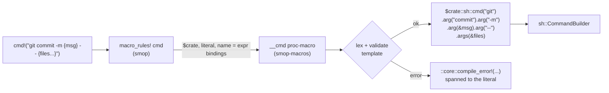

# ADR 0007: `cmd!` as a Zero-Dependency Proc-Macro

## Status

Accepted (0.4.0). Planned; not implemented yet. Extends
[ADR 0005](0005-cross-platform-shell-execution.md) and
[ADR 0006](0006-granular-core-features.md).

## Context

`sh::cmd("git").args(["commit", "-m", &msg])` gets argument quoting right,
but long command lines are hard to read. `sh::run("git commit -m ...")` reads
well, but it goes through a shell, so building one with `format!` lets values
be word-split or interpreted as shell syntax. Scripts want both: a command
line that reads like the shell and argv that can't be split or injected.

xshell's `cmd!` shows the shape:

```rust
let out = cmd!("git commit -m {msg} -- {files...}").run()?;
// argv: ["git", "commit", "-m", <msg>, "--", <file>, <file>, ...]
```

`{msg}` names a local and becomes exactly one argument. `{files...}` spreads
a list into one argument per item. Nothing is ever word-split again, and
there is no shell.

### Implicit capture needs a proc-macro

Making `{msg}` refer to the local `msg` means turning text inside a string
literal into an identifier. On stable Rust only `format_args!` can do that,
and it refuses when the literal comes from another macro ("`format_args!`
cannot capture variables when the format string is expanded from a macro",
[RFC 2795](https://rust-lang.github.io/rfcs/2795-format-args-implicit-identifiers.html)).
The output of `format_args!` can't be taken apart either, because
`fmt::Arguments` has no public structure. So a `macro_rules!` macro can
validate a template at compile time, but every value has to be listed again
after it: `cmd!("git commit -m {msg}", msg)`.

### "Proc-macros don't cache"

The worry was that a proc-macro would make rebuilds slower because its
output isn't cached. We investigated this before deciding:

- **rustc caches no macro expansion, of any kind.** Parsing, expansion and
  name resolution run for the whole crate on every compile of that crate,
  inside the `eval_always` query `resolver_for_lowering_raw`. Its provider
  calls `configure_and_expand`, and incremental reuse only starts after
  lowering to HIR ([rustc-dev-guide](https://rustc-dev-guide.rust-lang.org/overview.html),
  `compiler/rustc_interface/src/passes.rs`). We measured it: after a
  comment-only edit, or just a `touch`, all 200 proc-macro `cmd!` calls in a
  test crate ran again across all 4 modules, and so did all 200 calls of a
  `macro_rules!` version (`-Zmacro-stats`).
- **cargo skips rustc entirely when nothing changed**, so no macro runs on a
  no-op build (0.023 s).
- **The only expansion cache is nightly `-Zcache-proc-macros`, for derives
  only.** It was merged in rust-lang/rust#145354 (1.94) and is tracked in
  rust-lang/rust#151364. The Unstable Book calls it potentially unsound,
  because proc-macros may be impure. With it on, derive re-runs went from 4
  to 0, but function-like calls stayed at 200.

A proc-macro's real costs are at the build-system level, and they are
one-time:

- It is an extra host crate. cargo builds it once per profile (dev,
  release), per `RUSTFLAGS` set (only when no `--target` is passed) and per
  target dir. Switching back to an earlier setting reuses the earlier build.
- [sccache can't cache](https://github.com/mozilla/sccache/blob/main/docs/Rust.md)
  `proc-macro` crates.
- `cargo check` has to build it fully (codegen and link). The artifact is
  then shared with `cargo build`, `test`, `doc` and `clippy`.
- `cargo script` is still nightly-only (stabilization in rust-lang/cargo#16569
  is FCP-blocked), and it keys each script's build dir by the script's path.
  So every new or moved script compiles its dependencies once, the macro
  crate included.
- rust-analyzer can expand it only after cargo has built it.

### Measurements

These were taken on 1.97.0 (and spot-checked on 1.88), with five prototypes
that produce identical argv: two `macro_rules!` + `const fn` designs (one
with positional placeholders, one with named ones), a runtime template
function, a token-based macro, and a zero-dependency proc-macro. Each test
crate had 200 calls. Times are medians in seconds.

| Scenario | Plain builder | Proc-macro | Named `macro_rules!` | Positional `macro_rules!` |
|---|---|---|---|---|
| Edit one fn body, `cargo build` | 0.101 | 0.109 | 0.289 | 0.245 |
| Edit one fn body, `cargo check` | 0.080 | 0.079 | 0.197 | 0.205 |
| Clean `cargo build` | 0.38 | 0.77 | 1.29 | 1.12 |

The `macro_rules!` designs validate the template with const evaluation and
type-check a dispatch per argument at every call site. That costs about
0.6 to 0.9 ms per call on every rebuild of the crate. The proc-macro costs
about 0.04 ms per call. Its own clean build is about 0.33 s in isolation
(0.19 s in release), but inside smop's real dependency graph it builds in
parallel with `anyhow`, `tempfile` and `which`, so wall time didn't change:

| smop features | Clean build without | Clean build with the macro crate |
|---|---|---|
| `sh` | 0.76 s | 0.80 s |
| `sh,fs,path` | 2.25 s | 2.18 s |
| `full` | 22.7 s | 22.8 s |

At script sizes (10 to 50 calls) every design is within about 0.03 s per
rebuild, so build speed doesn't decide this. What the numbers do show is
that the proc-macro is not the slow option.

## Decision

Ship `cmd!` as a function-like proc-macro in a new crate, `smop-macros`. It
has no dependencies: it uses the bare `proc_macro` API, with no `syn`,
`quote` or `proc-macro2`. A thin `macro_rules!` wrapper in smop is the
public entry point. There is exactly one implementation; no second
`macro_rules!` parser ships next to it.

### Crates and features

```toml
# smop/Cargo.toml
[workspace]
members = ["smop-macros"]          # tests/consumer keeps its own [workspace]

[features]
full   = [ ..., "macros"]
sh     = []                        # unchanged: still pulls in nothing
macros = ["sh", "dep:smop-macros"]

[dependencies]
smop-macros = { version = "=0.4.0", path = "smop-macros", optional = true }
```

```toml
# smop-macros/Cargo.toml
[package]
name = "smop-macros"
rust-version = "1.88"

[lib]
proc-macro = true

[dependencies]                     # none
```

- `sh` stays dependency-free, as ADR 0006 promises. An xtask on
  `sh,fs,path` adds `macros` to get `cmd!`. That costs one extra crate with
  no dependencies of its own.
- The versions are pinned in lock-step (`=0.4.0`). `smop-macros` is
  published first.
- `#[macro_export] macro_rules! cmd` lives in `src/sh.rs` under
  `cfg(feature = "macros")`. The proc-macro is re-exported as a hidden item.
  The prelude gains `#[cfg(feature = "macros")] pub use crate::cmd;`
  ([ADR 0003](0003-prelude-design-philosophy.md)).

### How it expands



The wrapper handles `name = expr` arguments, so the proc-macro never has to
parse Rust expressions:

```rust
#[macro_export]
macro_rules! cmd {
    ($template:literal $(, $name:ident = $value:expr)* $(,)?) => {
        match ($(&$value,)*) {
            ($($name,)*) => $crate::__private::__cmd!($crate $template $($name)*),
        }
    };
}
```

- Each value is evaluated once, left to right, and borrowed.
- The proc-macro receives the `$crate` token and emits only `$crate::`
  paths and `::core::compile_error!`. That's why a script needs no direct
  dependency on `smop-macros`.
- The proc-macro also receives the listed names, so a listed name that the
  template never uses is a compile error, as it is with `format!`.
- Identifiers for `{name}` are created with the literal's span, so they
  resolve at the call site. This was verified to work through a user's own
  forwarding `macro_rules!`.

### Template grammar

The grammar starts strict. Each later relaxation is an additive change.

| Rule | Example | Result |
|---|---|---|
| The template is a string literal (raw strings allowed). | `cmd!(TEMPLATE)` | compile error |
| ASCII whitespace (space, `\t`, `\n`, `\r`, `\x0C`) separates words. Templates may span lines. | `"cargo test\n  --workspace"` | `["cargo","test","--workspace"]` |
| Other whitespace outside quotes is an error: `\x0B`, NBSP, U+2000–U+200B, U+3000 and so on. | `"ls\u{a0}-la"` | compile error |
| An empty or blank template is an error. | `""` | compile error |
| The first word is the program. It may be `{name}`, but not a splat. | `"{cargo} fmt"` | program from a local |
| `{name}` is exactly one argument and may be glued to text. | `"--out={dir}"`, `"{user}@{host}:{path}"` | one element each |
| `{name}` accepts `AsRef<OsStr>` values (passed verbatim, no UTF-8 round trip), plus integer primitives and `char`. Other types need `.to_string()`. | `"-j{jobs}"` with `jobs: usize` | `"-j8"` |
| `{name...}` splices zero or more arguments from anything iterable by reference (`&T: IntoIterator<Item: AsRef<OsStr>>`): `Vec`, slices, arrays, `Option`, sets. | `"{verbose...}"` with `Option<&str>` | 0 or 1 elements |
| A splat must be a whole word: not glued, not quoted, not the program. | `"--x={xs...}"` | compile error |
| A splat of a `Path`/`PathBuf` is an error, since splitting a path into components is never intended. | `"ls {p...}"` | compile error: "a path is one argument; write `{p}`" |
| `'...'` and `"..."` group words. There are no escapes inside, and placeholders still interpolate. `''` is an empty argument. | `"-m 'Release {v}'"` | `["-m","Release 1.2.0"]` |
| An opening quote must start a word or follow `=`. A closing quote must end the word. An unclosed quote is an error. | `"echo 'don't'"` | compile error, with the hint "for an apostrophe, quote with \"...\"" |
| `{{` and `}}` are literal braces. | `"find . -exec rm {{}} ';'"` | `["find",".","-exec","rm","{}",";"]` |
| Unquoted shell syntax is an error: the words `\|` `\|\|` `&` `&&` `;` `>` `>>` `<` `2>` `2>&1` `&>` `\|&`, and words starting with `$` + name, `${`, `$(` or `~`. | `"rm -f {f} && echo done"` | compile error: "cmd! runs one program, not a shell: quote it, or use `sh::run`" |
| `{}`, `{0}`, `{x:?}` and `{a.b}` are reserved. | `"echo {}"` | compile error |
| The result is the ordinary `sh::CommandBuilder`. | `cmd!(..).dir(&root).env(..).run()?` | unchanged builder API |

Notes on the rules:

- **A bare `;` is rejected, even though `find -exec` uses it.** It is a
  shell separator, so a bare `;` is far more likely a habit carried over
  from bash than an argument. `find` users write `';'`, which is also what
  a shell needs.
- **Globs are not rejected.** `*.rs` reaches the program as literal text.
  `find -name *.rs` relies on that, and a program that gets an unexpanded
  glob usually fails loudly ("No such file").
- **Each rule comes from a failure the prototypes showed:**
  - `rm -f {f} && echo done` deleted a file named `done` and returned `Ok`.
  - `'Don't break' --author 'O'Brien'` silently regrouped into two different
    arguments.
  - `{p...}` with a `PathBuf` became `["/", "usr", "local", "lib"]`.
  - A positional design let swapped arguments of the same type compile.

### Errors

- Template errors are `compile_error!`s spanned to the whole literal. On
  stable, nothing can point inside a literal, because `Literal::subspan` is
  unstable (`proc_macro_span`). The message quotes the offending fragment
  instead.
- Errors are ordinary compile errors, so `cargo check`, clippy and
  rust-analyzer's check on save report them. (A `macro_rules!` design would
  have had to avoid inline `const {}` blocks: their panics are not evaluated
  in check builds, and appear only on a full build. This was verified on
  1.88 and 1.97.)
- A typo in a captured name is rustc's E0425 ("cannot find value
  `verison`"). Its suggested fix replaces the whole template literal with
  the similar name. Applying the fix would delete the template. There's no
  stable way to narrow that span, so the docs warn about it.

### Testing

- The lexer and validator are plain functions over `&str`, separate from
  token handling. They get unit tests and proptest round trips: every
  `{name}` maps to exactly one argv element, and literal text never splits
  a value. They are also a candidate for a Verus spec. This is the one pure
  piece of smop where a proof pays for itself.
- A compile-fail suite covers every error rule above.
- The `tests/consumer` crate enables `macros` and calls `cmd!`. That proves
  the `$crate` paths work without a direct dependency on `smop-macros`.
- CI adds `macros` to the per-feature test and clippy loops, and runs
  `cargo test --workspace`.
- These regression cases from the prototypes become required tests:
  hostile values as single, glued, quoted, program and splat arguments
  (`; rm -rf / #`, `$(id)`, newline, empty string, `{}`, both quote
  characters, NBSP, non-UTF-8 bytes); `{{}}`, `{{{x}}}` and `}}{{`;
  `{a}{b}` gluing into one element; evaluation order; hygiene for locals
  named like internal bindings; capture through a forwarding macro.

## Alternatives Considered

1. **Named `macro_rules!` + `const fn`** (`cmd!("git commit -m {msg}", msg)`).
   This is the best design without a proc-macro, and it was the fallback.
   Every name is written twice. Rebuilds cost 2.5 to 2.9 times as much as
   plain code at 200 calls. Its error messages are limited to what a const
   panic can format, and they underline the whole call.
2. **Positional `macro_rules!`** (`cmd!("cp {} {}", src, dst)`). Swapped
   arguments of the same type compile silently, and values are moved, not
   borrowed. Its `$template:expr` would accept const items, which a later
   proc-macro could never accept, so that would have been a semver trap.
3. **A runtime template** (`sh::template("cp {} {}", (a, b))`). Template
   errors only appear when the line runs. A variant checked through an
   inline `const {}` block fails only on a full build, so `cargo check` and
   rust-analyzer miss it.
4. **A token macro** (`cmd!(git commit (-m) {msg})`). It rebuilds words
   from `stringify!` spacing, which is unspecified. `git add .` becomes
   `["git","add."]`, rustfmt rewrites `rm -rf {dir}` to `rm - rf { dir }`,
   and a `/* */` across glob words silently drops text.
5. **A hybrid**: the named `macro_rules!` design plus an opt-in proc-macro
   that only appends missing names. It works, and it was verified on 1.88
   and 1.97. But getting capture still needs a published proc-macro crate,
   the slower const-eval path stays, and two scanners must agree on what a
   placeholder is.
6. **A `syn`-based proc-macro.** The `syn` + `quote` + `proc-macro2` stack
   is about 3.0 s of clean build against about 0.3 s, and a string grammar
   doesn't need it.

## Consequences

### Positive

- Shell-like command lines with no word splitting and no shell injection,
  checked at compile time and reported by `cargo check`, clippy and
  rust-analyzer.
- The same syntax as xshell, and close to `format!`, so it is easy to learn.
- It is the cheapest macro on every rebuild, about as cheap as hand-written
  builder calls.
- The parser is ordinary Rust, so its error messages use `format!` and it
  can be tested directly.
- `sh` and the xtask feature set (`sh,fs,path`) keep their dependency list.

### Negative

- A second published crate. Releases need a lock-step version pin and the
  right publish order.
- About 0.3 s CPU per clean build per profile, `RUSTFLAGS` set and target
  dir. In smop's graph this is hidden by parallel builds, but it shows at
  `-j1`. sccache can't cache it.
- rust-analyzer needs the macro built, and depends on the toolchain's
  proc-macro server.
- Errors underline the whole literal, and rustc's suggestion for a misspelled
  captured name is destructive (see Errors).
- xtasks on `sh,fs,path` must add `macros` to use `cmd!`.

### To verify during implementation

- How rust-analyzer displays expansion and errors. It wasn't installed where
  the prototypes ran.
- Clippy on 1.88 at call sites. Only 1.97 clippy was available.

## References

- [RFC 2795: implicit named arguments in format strings](https://rust-lang.github.io/rfcs/2795-format-args-implicit-identifiers.html)
- [rustc-dev-guide: overview](https://rustc-dev-guide.rust-lang.org/overview.html)
  and [incremental compilation in detail](https://rustc-dev-guide.rust-lang.org/queries/incremental-compilation-in-detail.html)
- [Unstable Book: `-Zcache-proc-macros`](https://doc.rust-lang.org/unstable-book/compiler-flags/cache-proc-macros.html),
  rust-lang/rust#145354, rust-lang/rust#151364
- [sccache: Rust](https://github.com/mozilla/sccache/blob/main/docs/Rust.md)
- [Cargo book: build cache](https://doc.rust-lang.org/cargo/reference/build-cache.html)
  and [profiles](https://doc.rust-lang.org/cargo/reference/profiles.html#build-dependencies)
- rust-lang/cargo#16569 (cargo script stabilization), rust-lang/rust#148051 (frontmatter)
- [xshell](https://docs.rs/xshell) and [xshell-macros](https://docs.rs/xshell-macros)
- [`uuid!`](https://docs.rs/uuid/latest/uuid/macro.uuid.html), prior art for `const`-item validation
